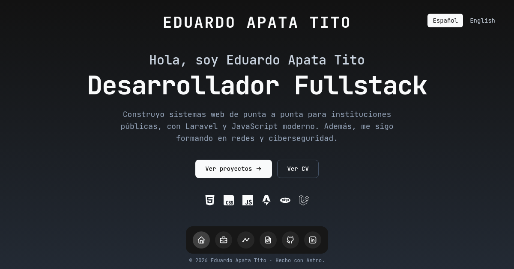

# Eduardo Apata Tito · Portfolio

[](https://eduardoapata.cl)

Portfolio personal de Eduardo Apata Tito, desarrollador fullstack. Reúne proyectos, experiencia y CV, en español e inglés.

**Sitio:** [eduardoapata.cl](https://eduardoapata.cl)

Es un sitio estático hecho con Astro: cada sección tiene su propia URL, la barra de navegación se queda fija y solo cambia el contenido, con una transición corta.

## Qué tiene el sitio

| Ruta (ES / EN)                      | Contenido                                                                       |
| ----------------------------------- | ------------------------------------------------------------------------------- |
| `/` · `/en/`                        | Tarjeta de perfil (correo para copiar, hora de Arica) y resumen de cada sección |
| `/proyectos/` · `/en/projects/`     | Tarjetas con estado, descripción, chips de tecnologías, enlaces y captura       |
| `/experiencia/` · `/en/experience/` | Línea de tiempo por año, con una tarjeta por puesto                             |
| `/cv/` · `/en/resume/`              | CV como hoja, con descarga del PDF                                              |

- **Barra de navegación** con pestañas por sección; en celular bajan a una segunda fila (`src/components/SiteHeader.astro`). El dock con magnificación de la versión anterior queda guardado sin usarse (`src/components/Dock.astro` y `src/scripts/dock.ts`).
- **Menú de comandos** (Ctrl/⌘ + K) para navegar, copiar el correo, descargar el CV, abrir redes y cambiar de idioma, con `<dialog>` y JS sin dependencias (`src/scripts/command-menu.ts`).
- **Transiciones** entre secciones con View Transitions (`<ClientRouter />`).
- **Accesible:** navegación por teclado, enlace para saltar al contenido, `prefers-reduced-motion` respetado y revisado con axe-core (WCAG 2.2 AA).
- **SEO:** título y descripción únicos por página e idioma, Open Graph, datos estructurados (`ProfilePage`), sitemap con pares de idioma, `robots.txt` y página 404.

## Tecnologías

| Tecnología                                                                         | Para qué se usa                                                         |
| ---------------------------------------------------------------------------------- | ----------------------------------------------------------------------- |
| [Astro 7](https://astro.build)                                                     | Sitio estático, colecciones de contenido, i18n, transiciones e imágenes |
| TypeScript                                                                         | Tipado estricto en componentes, contenido y scripts                     |
| [Tailwind CSS 4](https://tailwindcss.com)                                          | Estilos, con los tokens de color en `@theme` (`src/styles/global.css`)  |
| [JetBrains Mono](https://www.jetbrains.com/lp/mono/)                               | Tipografía única, cargada con la API de fuentes de Astro                |
| [astro-icon](https://github.com/natemoo-re/astro-icon)                             | Íconos de Lucide y Simple Icons                                         |
| [@astrojs/sitemap](https://docs.astro.build/en/guides/integrations-guide/sitemap/) | Sitemap con las versiones de cada idioma                                |
| [ESLint](https://eslint.org) y [Prettier](https://prettier.io)                     | Revisión y formato del código, con los plugins de Astro                 |

## Cómo correrlo

Requiere Node 22.23 o superior y [pnpm](https://pnpm.io).

```sh
pnpm install
pnpm dev
```

El sitio queda en `http://localhost:4321`.

| Comando             | Qué hace                                        |
| :------------------ | :---------------------------------------------- |
| `pnpm dev`          | Servidor de desarrollo                          |
| `pnpm build`        | Genera el sitio estático en `dist/`             |
| `pnpm preview`      | Sirve el build para revisarlo antes de publicar |
| `pnpm check`        | Revisa los tipos de TypeScript y Astro          |
| `pnpm lint`         | Revisa el código con ESLint                     |
| `pnpm format`       | Aplica el formato de Prettier                   |
| `pnpm format:check` | Revisa el formato sin modificar archivos        |

## Estructura

```text
cv/CV.tex            Fuente LaTeX del CV (versión sin teléfono)
public/
├── cv/              PDF del CV que se descarga desde la web
└── og/              Imágenes para compartir en redes (1200 × 630)
src/
├── assets/projects/ Capturas de los proyectos (Astro las optimiza)
├── components/      Barra de navegación, menú de comandos, panel, tarjetas, etiquetas, SEO y fondo
├── content/         Proyectos y experiencia, en carpetas es/ y en/
├── data/            Perfil (profile.ts), secciones del CV (cv.ts) e íconos de tecnologías (tech.ts)
├── i18n/            Textos de la interfaz y rutas de cada idioma
├── layouts/         Layout base
├── lib/             Consultas de contenido, formato de fechas, SEO y transiciones
├── pages/           Rutas en español; en/ para inglés
├── scripts/         Menú de comandos, portapapeles y dock (guardado)
├── styles/          Estilos globales y tokens
└── views/           Contenido de cada página, compartido entre idiomas
```

## Cómo actualizar el contenido

### Agregar un proyecto

Crea un archivo por idioma en `src/content/projects/es/` y `src/content/projects/en/`, con el mismo nombre. La captura va en `src/assets/projects/`.

```md
---
title: Mi proyecto
year: 2026
category: Sitio web
summary: Una línea para la tarjeta del inicio # opcional
status: produccion # desarrollo | prototipo | produccion (opcional)
tech: [Astro, TypeScript]
url: https://mi-proyecto.vercel.app # opcional
repo: https://github.com/eduardoapatat/mi-proyecto # opcional
order: 3 # menor número = aparece antes
image: ../../../assets/projects/mi-proyecto.webp # opcional
imageAlt: Descripción de la captura
---

Descripción del proyecto en Markdown. Las **negritas** se destacan en la tarjeta.
```

Cada nombre de `tech` se muestra con su ícono si está en `src/data/tech.ts` (ícono de Simple Icons y color de marca); si no, como texto.

### Agregar experiencia

Igual que los proyectos, en `src/content/experience/es/` y `en/`. Sin `end`, el trabajo se muestra como actual.

```md
---
company: Empresa
role: Cargo
type: practica # practica | ayudantia | empleo | freelance (opcional)
location: Arica, Chile
start: 2026-01-01
end: 2026-03-01
---

- Logro concreto, empezando con un verbo.
```

### Actualizar el CV

1. Edita el `.tex` y compílalo (el original vive fuera del repo; `cv/CV.tex` es la copia sin teléfono).
2. Reemplaza `public/cv/eduardo-apata-tito-cv-es.pdf` con el PDF nuevo.
3. Refleja los cambios en la web: resumen, educación, certificaciones, habilidades y tecnologías en `src/data/cv.ts`, y la experiencia en `src/content/experience/`.

## Publicación

Se publica en **Cloudflare Workers** como sitio estático (`wrangler.jsonc`): cada push a `main` construye y despliega el sitio en [eduardoapata.cl](https://eduardoapata.cl). En el proyecto de Cloudflare (Workers Builds):

- **Build command:** `pnpm build`
- **Deploy command:** `npx wrangler deploy`

Variables de build:

| Variable                          | Para qué                                                                                                                                   |
| --------------------------------- | ------------------------------------------------------------------------------------------------------------------------------------------ |
| `SITE_URL`                        | URL pública (ej. `https://eduardoapata.cl`). Activa canónicas, `hreflang`, Open Graph absoluto y sitemap. Sin ella el sitio compila igual. |
| `PUBLIC_GOOGLE_SITE_VERIFICATION` | Opcional: código para verificar el sitio en Google Search Console                                                                          |

La versión de Node sale de `.node-version` y la de pnpm, de `packageManager` en `package.json`. pnpm también la registra en `pnpm-lock.yaml`, y Cloudflare instala con el lockfile congelado: al actualizar pnpm (`pnpm self-update`), corre `pnpm install` y sube **ambos** archivos en el mismo commit, o el build falla.

Para probar el sitio en el runtime de Cloudflare: `pnpm build && pnpm exec wrangler dev`.

Después de publicar, envía `https://eduardoapata.cl/sitemap-index.xml` en Google Search Console.
